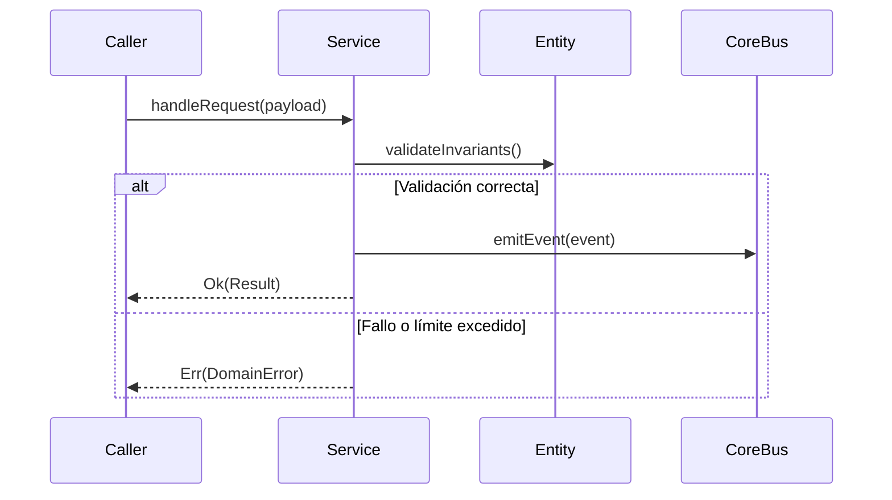

# Módulo: Panel de Administración y Moderación Familiar (MOD-admin)

```yaml
module_id: MOD-admin
name: "Panel de Administración y Moderación Familiar"
target_path: "src/admin/"
scope: "block_admin.md"
owner: "Product Engineering"
version: "1.0.0"
last_updated: "2026-11-11"
```

---

## 1. Propósito y Responsabilidades

Es la autoridad funcional responsable de **Interruptor global registration_open, gestión de emails en whitelist, aprobación manual de accesos pendientes y purga total de datos de usuario.** dentro de `DondeEstan`.

### Lo que hace
- Modela las entidades, estados y contratos que gobiernan Panel de Administración y Moderación Familiar.
- Expone interfaces públicas tipadas para su consumo por otros módulos o agentes.
- Garantiza la idempotencia y la consistencia transaccional de su subsistema.

### Lo que NO hace
- No accede directamente a la persistencia interna de otros módulos.
- No duplica utilidades de red, logging o contratos ya resueltos en `core`.
- No almacena secretos ni credenciales en código fuente.

---

## 2. Contratos y Tipos Públicos (CT-*)

### CT-01: Modelo inmutable de datos y entidades (AdminEntity)
- **Símbolo / Archivo:** `src/admin/contracts/admin_models.ts::AdminServiceContract`
- **Invariantes:** Estructuras inmutables con validación estricta de esquema y tipado.

### CT-02: Servicio de orquestación y reglas de negocio (AdminService)
- **Símbolo / Archivo:** `src/admin/services/admin_service.ts::AdminService`
- **Invariantes:** Métodos asíncronos con manejo de excepciones tipadas.

### CT-03: Servicio de gestión de Grupos (GroupService)
- **Símbolo / Archivo:** `src/admin/group_service.ts::GroupService`
- **Invariantes:** CRUD de grupos, asignación multi-grupo, pertenencia global del admin (BR-GRP-01) y purga en cascada (BR-GRP-02).

---

## 3. Reglas de Negocio e Invariantes (BR-*)

- **BR-ADMIN-01:** Toda entidad de Panel de Administración y Moderación Familiar valida sus invariantes en el constructor.
- **BR-ADMIN-02:** Las operaciones externas que puedan fallar devuelven un Result tipado.
- **BR-GRP-01:** El administrador tiene acceso y pertenencia automática a todos los grupos creados.
- **BR-GRP-02:** Al eliminar un grupo se desvincula de todos los usuarios; aquellos sin grupos quedan en espera de asignación.
- **BR-ADM-03:** Al eliminar un usuario (`purgeMember`), se eliminan sus datos de Firestore (`/users/{uid}` y `/whitelist/{email}`) y se purga su cuenta de Firebase Authentication (`BR-AUTH-03`).

---

## 4. Flujos y Ciclos de Vida



---

## 5. Mapa de implementación

| Contrato / Flujo | Símbolo de Código | Ruta en Disco | Pruebas Unitarias |
|---|---|---|---|
| CT-01 | `WhitelistRecord`, `SystemConfig`, `Group` | `src/admin/types.ts` | `tests/unit/admin/admin_service.test.ts` |
| CT-02 | `AdminService` | `src/admin/admin_service.ts` | `tests/unit/admin/admin_service.test.ts` |
| CT-03 | `GroupService` | `src/admin/group_service.ts` | `tests/unit/admin/group_service.test.ts` |
| UI-01 | `renderAdminView` | `src/admin/views/AdminView.ts` | Compilación e integración Vite |
