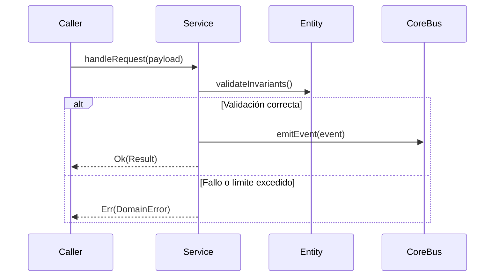

# Módulo: Panel de Administración y Moderación Familiar (MOD-admin)

```yaml
module_id: MOD-admin
name: "Panel de Administración y Moderación Familiar"
target_path: "src/admin/"
scope: "block_admin.md"
owner: "Product Engineering"
version: "1.0.0"
last_updated: "2026-11-11"
```

---

## 1. Propósito y Responsabilidades

Es la autoridad funcional responsable de **Interruptor global registration_open, gestión de emails en whitelist, aprobación manual de accesos pendientes y purga total de datos de usuario.** dentro de `DondeEstan`.

### Lo que hace
- Modela las entidades, estados y contratos que gobiernan Panel de Administración y Moderación Familiar.
- Expone interfaces públicas tipadas para su consumo por otros módulos o agentes.
- Garantiza la idempotencia y la consistencia transaccional de su subsistema.

### Lo que NO hace
- No accede directamente a la persistencia interna de otros módulos.
- No duplica utilidades de red, logging o contratos ya resueltos en `core`.
- No almacena secretos ni credenciales en código fuente.

---

## 2. Contratos y Tipos Públicos (CT-*)

### CT-01: Modelo inmutable de datos y entidades (AdminEntity)
- **Símbolo / Archivo:** `src/admin/contracts/admin_models.ts::AdminServiceContract`
- **Invariantes:** Estructuras inmutables con validación estricta de esquema y tipado.

### CT-02: Servicio de orquestación y reglas de negocio (AdminService)
- **Símbolo / Archivo:** `src/admin/services/admin_service.ts::AdminService`
- **Invariantes:** Métodos asíncronos con manejo de excepciones tipadas.

---

## 3. Reglas de Negocio e Invariantes (BR-*)

- **BR-ADMIN-01:** Toda entidad de Panel de Administración y Moderación Familiar valida sus invariantes en el constructor.
- **BR-ADMIN-02:** Las operaciones externas que puedan fallar devuelven un Result tipado.

---

## 4. Flujos y Ciclos de Vida



---

## 5. Mapa de implementación

| Contrato / Flujo | Símbolo de Código | Ruta en Disco | Pruebas Unitarias |
|---|---|---|---|
| CT-01 | `AdminServiceContract` | `src/admin/contracts/admin_models.ts` | `tests/unit/admin/models_test.ts` |
| CT-02 | `AdminService` | `src/admin/services/admin_service.ts` | `tests/unit/admin/service_test.ts` |
