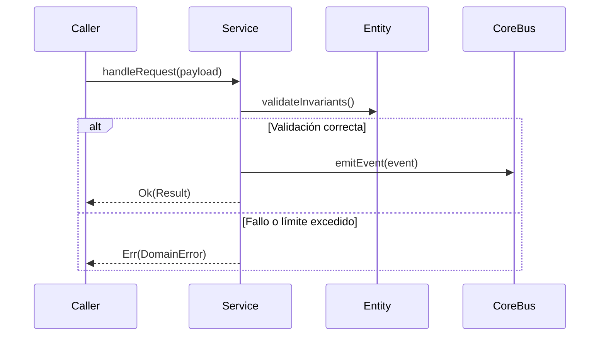

# Módulo: Autenticación, Whitelist y Control de Acceso (MOD-auth)

```yaml
module_id: MOD-auth
name: "Autenticación, Whitelist y Control de Acceso"
target_path: "src/auth/"
scope: "block_auth.md"
owner: "Product Engineering"
version: "1.0.0"
last_updated: "2026-11-11"
```

---

## 1. Propósito y Responsabilidades

Es la autoridad funcional responsable de **Flujo de registro y login cerrado contra /whitelist/{email}, asignación de estado pending_approval en Firestore y vista fija gatekeeper de bloqueo.** dentro de `DondeEstan`.

### Lo que hace
- Modela las entidades, estados y contratos que gobiernan Autenticación, Whitelist y Control de Acceso.
- Expone interfaces públicas tipadas para su consumo por otros módulos o agentes.
- Garantiza la idempotencia y la consistencia transaccional de su subsistema.

### Lo que NO hace
- No accede directamente a la persistencia interna de otros módulos.
- No duplica utilidades de red, logging o contratos ya resueltos en `core`.
- No almacena secretos ni credenciales en código fuente.

---

## 2. Contratos y Tipos Públicos (CT-*)

### CT-01: Modelo inmutable de datos y entidades (AuthEntity)
- **Símbolo / Archivo:** `src/auth/contracts/auth_models.ts::AuthServiceContract`
- **Invariantes:** Estructuras inmutables con validación estricta de esquema y tipado.

### CT-02: Servicio de orquestación y reglas de negocio (AuthService)
- **Símbolo / Archivo:** `src/auth/services/auth_service.ts::AuthService`
- **Invariantes:** Métodos asíncronos con manejo de excepciones tipadas.

---

## 3. Reglas de Negocio e Invariantes (BR-*)

- **BR-AUTH-01:** Toda entidad de Autenticación, Whitelist y Control de Acceso valida sus invariantes en el constructor.
- **BR-AUTH-02:** Las operaciones externas que puedan fallar devuelven un Result tipado.

---

## 4. Flujos y Ciclos de Vida



---

## 5. Mapa de implementación

| Contrato / Flujo | Símbolo de Código | Ruta en Disco | Pruebas Unitarias |
|---|---|---|---|
| CT-AUTH-01 | `verifyEmailEligibility` | `src/auth/whitelist.ts` | `tests/unit/auth/whitelist.test.ts` |
| CT-AUTH-02 | `FamilyAuthService` | `src/auth/auth_service.ts` | `tests/unit/auth/whitelist.test.ts` |
| CT-AUTH-03 | `isUserApproved` / `shouldShowGatekeeper` | `src/auth/gatekeeper.ts` | `tests/unit/auth/gatekeeper.test.ts` |
