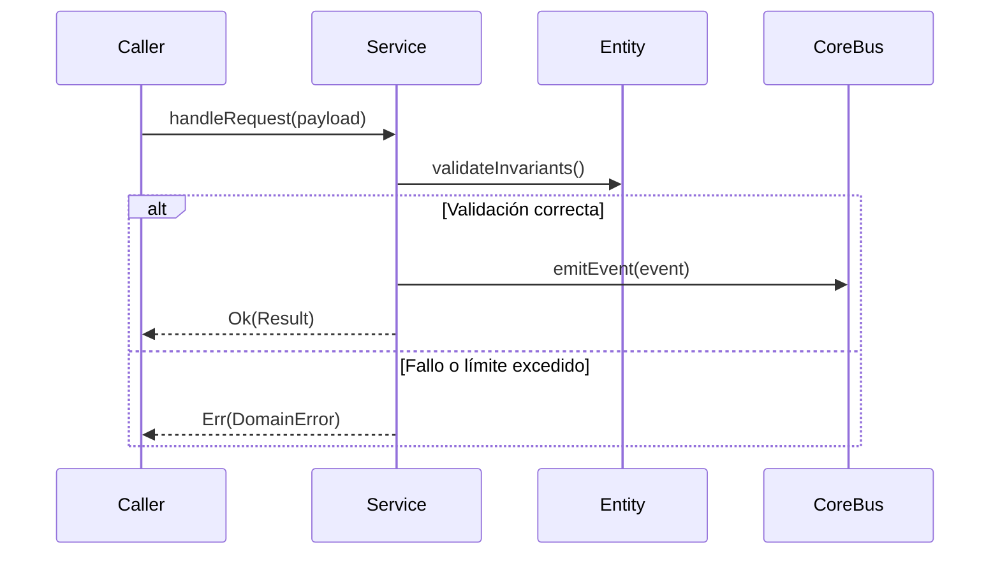

# Módulo: Canal Único de Chat Grupal Familiar (MOD-chat)

```yaml
module_id: MOD-chat
name: "Canal Único de Chat Grupal Familiar"
target_path: "src/chat/"
scope: "block_chat.md"
owner: "Product Engineering"
version: "1.0.0"
last_updated: "2026-11-11"
```

---

## 1. Propósito y Responsabilidades

Es la autoridad funcional responsable de **Chat grupal reactivo para los 8 miembros, consulta limitada a los últimos 50 mensajes, desconexión activa del listener onSnapshot al cambiar de vista y prevención de doble envío.** dentro de `DondeEstan`.

### Lo que hace
- Modela las entidades, estados y contratos que gobiernan Canal Único de Chat Grupal Familiar.
- Expone interfaces públicas tipadas para su consumo por otros módulos o agentes.
- Garantiza la idempotencia y la consistencia transaccional de su subsistema.

### Lo que NO hace
- No accede directamente a la persistencia interna de otros módulos.
- No duplica utilidades de red, logging o contratos ya resueltos en `core`.
- No almacena secretos ni credenciales en código fuente.

---

## 2. Contratos y Tipos Públicos (CT-*)

### CT-01: Adaptador de canales de distribución y entrega (ChatChannel)
- **Símbolo / Archivo:** `src/chat/contracts/chat_models.ts::ChatDispatcherContract`
- **Invariantes:** Estructuras inmutables con validación estricta de esquema y tipado.

### CT-02: Motor de optimización continua y métricas (ChatCROLoop)
- **Símbolo / Archivo:** `src/chat/services/chat_service.ts::ChatService`
- **Invariantes:** Métodos asíncronos con manejo de excepciones tipadas.

---

## 3. Reglas de Negocio e Invariantes (BR-*)

- **BR-CHAT-01:** Cero envíos masivos o spam sin valor contextual directo; respetar límites éticos y rate limiting.
- **BR-CHAT-02:** Las interacciones y eventos de conversión se registran de forma asíncrona y no invasiva.

---

## 4. Flujos y Ciclos de Vida



---

## 5. Mapa de implementación

| Contrato / Flujo | Símbolo de Código | Ruta en Disco | Pruebas Unitarias |
|---|---|---|---|
| CT-01 | `ChatDispatcherContract` | `src/chat/contracts/chat_models.ts` | `tests/unit/chat/models_test.ts` |
| CT-02 | `ChatService` | `src/chat/services/chat_service.ts` | `tests/unit/chat/service_test.ts` |
