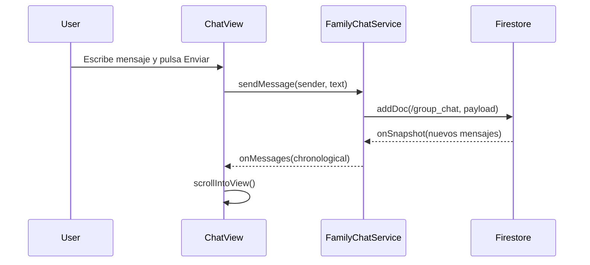

# Módulo: Canal Único de Chat Grupal Familiar (MOD-chat)

```yaml
module_id: MOD-chat
name: "Canal Único de Chat Grupal Familiar"
target_path: "src/chat/"
scope: "block_chat.md"
owner: "Product Engineering"
version: "1.0.0"
last_updated: "2026-11-11"
```

---

## 1. Propósito y Responsabilidades

Es la autoridad funcional responsable de **Chat grupal reactivo para los 8 miembros, consulta limitada a los últimos 50 mensajes, desconexión activa del listener onSnapshot al cambiar de vista y prevención de doble envío.** dentro de `DondeEstan`.

### Lo que hace
- Modela las entidades, estados y contratos del canal grupal familiar.
- Servicio reactivo `FamilyChatService` con límite de 50 mensajes y orden cronológico.
- Vista de mensajería `ChatView` con diseño Kinetic Bloom y burbujas propias/ajenas.
- Gestión de ciclo de vida del listener para cuota Spark y ahorro de batería.

### Lo que NO hace
- No gestiona chats individuales ni subgrupos (canal único por especificación de producto).
- No permite edición ni borrado de mensajes por miembros estándar (inmutabilidad estricta).
- No almacena mensajes en memoria indefinidamente ni supera la cuota de 50 mensajes.

---

## 2. Contratos y Tipos Públicos (CT-*)

### CT-CHAT-01: Mensajes y Remitentes del Chat Grupal
- **Símbolo / Archivo:** `src/chat/types.ts::ChatMessage, ChatSender`
- **Invariantes:** Estructuras inmutables con validación estricta de esquema y tipado.

### CT-CHAT-02: Servicio de Mensajería Familiar
- **Símbolo / Archivo:** `src/chat/chat_service.ts::FamilyChatService`
- **Invariantes:** Consulta limitada a 50 mensajes, validación de 500 caracteres máx y rechazo de mensajes vacíos.

### CT-CHAT-03: Vista Reactiva de Conversación
- **Símbolo / Archivo:** `src/chat/views/ChatView.ts::renderChatView`
- **Invariantes:** Scroll automático a la base, input bloqueado durante envío y desconexión de listener al desmontar.

---

## 3. Reglas de Negocio e Invariantes (BR-*)

- **BR-CHAT-01:** Consulta acotada estrictamente a un máximo de 50 mensajes en `group_chat`.
- **BR-CHAT-02:** Desconexión activa obligatoria del listener `onSnapshot` al conmutar a otra pestaña.
- **BR-CHAT-03:** Mensajes inmutables (append-only) protegidos por reglas de seguridad.

---

## 4. Flujos y Ciclos de Vida



---

## 5. Mapa de implementación

| Contrato / Flujo | Símbolo de Código | Ruta en Disco | Pruebas Unitarias |
|---|---|---|---|
| CT-CHAT-01 | `ChatMessage, ChatSender` | `src/chat/types.ts` | `tests/unit/chat/chat_service.test.ts` |
| CT-CHAT-02 | `FamilyChatService` | `src/chat/chat_service.ts` | `tests/unit/chat/chat_service.test.ts` |
| CT-CHAT-03 | `renderChatView` | `src/chat/views/ChatView.ts` | `tests/unit/chat/chat_service.test.ts` |
