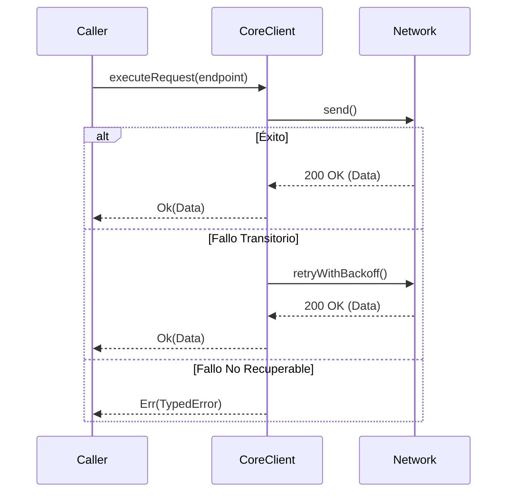

# Módulo: Infraestructura Base y Configuración Transversal (MOD-core)

```yaml
module_id: MOD-core
name: "Infraestructura Base y Configuración Transversal"
target_path: "src/core/"
scope: "block_core.md"
owner: "Architecture & Platform Team"
version: "1.0.0"
last_updated: "2026-11-11"
```

---

## 1. Propósito y Responsabilidades

Inicialización del SDK Firebase (Auth, Firestore, Storage), variables de entorno, utilidades comunes y registro del Service Worker PWA.

### Lo que hace
- Concentra la coordinación transversal, contratos base e interfaces públicas de `src/core/`.
- Contratos abstractos de persistencia (firebase).
- Modelado de excepciones tipadas y resultados inmutables (`Result[T, AppError]`).
- Bus interno de eventos y orquestación del ciclo de vida del sistema.

### Lo que NO hace
- No contiene lógica de presentación gráfica ni estilos CSS.
- No almacena secretos en texto plano ni credenciales fijas.
- No ejecuta llamadas de red sin timeout y reintentos finitos.

---

## 2. Contratos y Tipos Públicos (CT-*)

### CT-01: Contrato de Cliente HTTP Resiliente (`HttpClient`)
- **Símbolo / Archivo:** `src/core/http/client.ts::HttpClient`
- **Firma esperada:** `request(method, url, headers, params, body) -> Result[Response, NetworkError]`
- **Invariantes:** Timeout máximo declarado por petición; política de backoff exponencial en fallos transitorios (5xx).

### CT-02: Contrato de Persistencia Abstracta (`StorageContract`)
- **Símbolo / Archivo:** `src/core/storage/contract.ts::StorageContract`
- **Invariantes:** Operaciones de lectura y escritura idempotentes; aislamiento transaccional garantizado.

---

## 3. Reglas de Negocio e Invariantes (BR-*)

- **BR-CORE-01:** Cero excepciones no tipadas escapan a módulos de negocio. Todo error transitorio o fatal se encapsula en una jerarquía de error conocida.
- **BR-CORE-02:** Los clientes de red y persistencia no abren conexiones sin límite; deben declarar un pool finito y un timeout estricto.

---

## 4. Flujos y Ciclos de Vida



---

## 5. Mapa de implementación

| Contrato / Flujo | Símbolo de Código | Ruta en Disco | Pruebas Unitarias |
|---|---|---|---|
| CT-CORE-01 | `getFirebaseServices` / `isFirebaseConfigured` | `src/core/firebase.ts` | `tests/unit/auth/whitelist.test.ts` |
