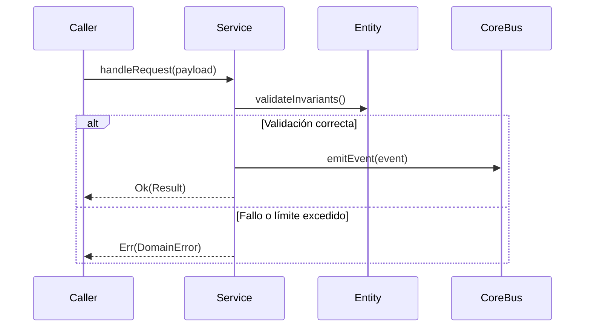

# Módulo: Geolocalización Reactiva y Google Maps (MOD-location)

```yaml
module_id: MOD-location
name: "Geolocalización Reactiva y Google Maps"
target_path: "src/location/"
scope: "block_location.md"
owner: "Product Engineering"
version: "1.0.0"
last_updated: "2026-11-11"
```

---

## 1. Propósito y Responsabilidades

Es la autoridad funcional responsable de **Gestión del ciclo de vida WebKit (visibilitychange), throttling adaptativo (30s/15m o 120s heartbeat), marcadores AdvancedMarkerElement y presencia online/offline.** dentro de `DondeEstan`.

### Lo que hace
- Modela las entidades, estados y contratos que gobiernan Geolocalización Reactiva y Google Maps.
- Expone interfaces públicas tipadas para su consumo por otros módulos o agentes.
- Garantiza la idempotencia y la consistencia transaccional de su subsistema.

### Lo que NO hace
- No accede directamente a la persistencia interna de otros módulos.
- No duplica utilidades de red, logging o contratos ya resueltos en `core`.
- No almacena secretos ni credenciales en código fuente.

---

## 2. Contratos y Tipos Públicos (CT-*)

### CT-01: Máquina de estados finitos y programación del ciclo (LocationState)
- **Símbolo / Archivo:** `src/location/contracts/location_models.ts::LocationEngineContract`
- **Invariantes:** Estructuras inmutables con validación estricta de esquema y tipado.

### CT-02: Controlador de eventos y transiciones (LocationEventDaemon)
- **Símbolo / Archivo:** `src/location/services/location_service.ts::LocationService`
- **Invariantes:** Métodos asíncronos con manejo de excepciones tipadas.

---

## 3. Reglas de Negocio e Invariantes (BR-*)

- **BR-LOCATION-01:** Toda transición de estado es atómica e idempotente; no se duplican ciclos de ejecución.
- **BR-LOCATION-02:** Los límites de presupuesto, timeouts y cuotas de servicio se verifican antes de transicionar.

---

## 4. Flujos y Ciclos de Vida



---

## 5. Mapa de implementación

| Contrato / Flujo | Símbolo de Código | Ruta en Disco | Pruebas Unitarias |
|---|---|---|---|
| CT-LOC-01 | `calculateDistanceMeters` | `src/location/geo_utils.ts` | `tests/unit/location/throttle.test.ts` |
| CT-LOC-02 | `LocationThrottleService` | `src/location/throttle.ts` | `tests/unit/location/throttle.test.ts` |
| CT-LOC-03 | `isUserLive` | `src/location/presence.ts` | `tests/unit/location/presence.test.ts` |
| CT-LOC-04 | `GeolocationTracker` | `src/location/tracker.ts` | `tests/unit/location/throttle.test.ts` |
| CT-LOC-05 | `FamilyMapService` | `src/location/map_service.ts` | `tests/unit/location/presence.test.ts` |
