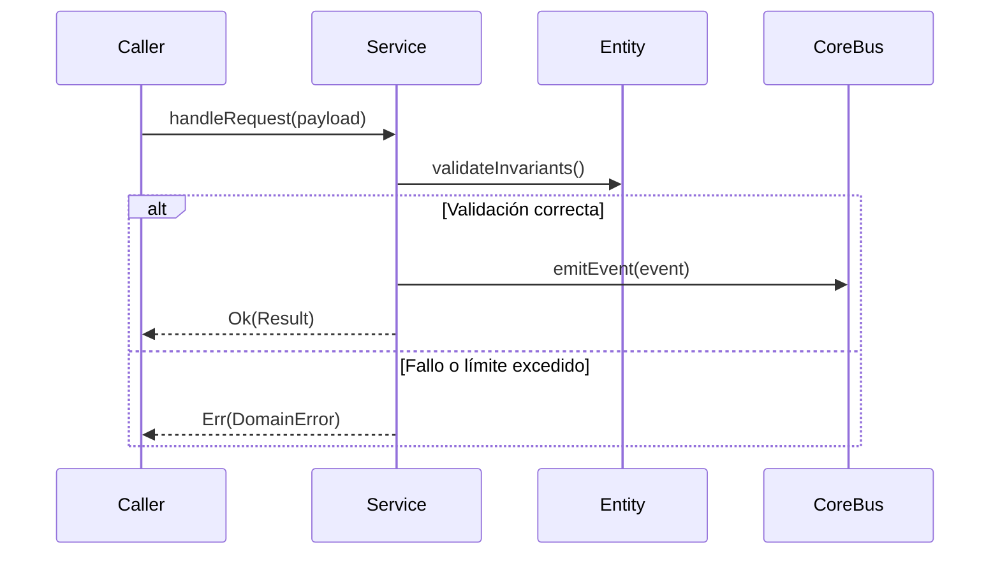

# Módulo: Perfil, Ajustes y Diagnóstico del Dispositivo (MOD-profile)

```yaml
module_id: MOD-profile
name: "Perfil, Ajustes y Diagnóstico del Dispositivo"
target_path: "src/profile/"
scope: "block_profile.md"
owner: "Product Engineering"
version: "1.0.0"
last_updated: "2026-11-11"
```

---

## 1. Propósito y Responsabilidades

Es la autoridad funcional responsable de **Edición de display_name, compresión y recorte de avatar en <canvas> (<300x300, <50KB) hacia Storage, diagnóstico de permisos GPS en Safari y logout.** dentro de `DondeEstan`.

### Lo que hace
- Modela las entidades, estados y contratos que gobiernan Perfil, Ajustes y Diagnóstico del Dispositivo.
- Expone interfaces públicas tipadas para su consumo por otros módulos o agentes.
- Garantiza la idempotencia y la consistencia transaccional de su subsistema.

### Lo que NO hace
- No accede directamente a la persistencia interna de otros módulos.
- No duplica utilidades de red, logging o contratos ya resueltos en `core`.
- No almacena secretos ni credenciales en código fuente.

---

## 2. Contratos y Tipos Públicos (CT-*)

### CT-01: Modelo inmutable de datos y entidades (ProfileEntity)
- **Símbolo / Archivo:** `src/profile/contracts/profile_models.ts::ProfileServiceContract`
- **Invariantes:** Estructuras inmutables con validación estricta de esquema y tipado.

### CT-02: Servicio de orquestación y reglas de negocio (ProfileService)
- **Símbolo / Archivo:** `src/profile/services/profile_service.ts::ProfileService`
- **Invariantes:** Métodos asíncronos con manejo de excepciones tipadas.

---

## 3. Reglas de Negocio e Invariantes (BR-*)

- **BR-PROFILE-01:** Toda entidad de Perfil, Ajustes y Diagnóstico del Dispositivo valida sus invariantes en el constructor.
- **BR-PROFILE-02:** Las operaciones externas que puedan fallar devuelven un Result tipado.

---

## 4. Flujos y Ciclos de Vida



---

## 5. Mapa de implementación

| Contrato / Flujo | Símbolo de Código | Ruta en Disco | Pruebas Unitarias |
|---|---|---|---|
| CT-01 | `ProfileServiceContract` | `src/profile/contracts/profile_models.ts` | `tests/unit/profile/models_test.ts` |
| CT-02 | `ProfileService` | `src/profile/services/profile_service.ts` | `tests/unit/profile/service_test.ts` |
