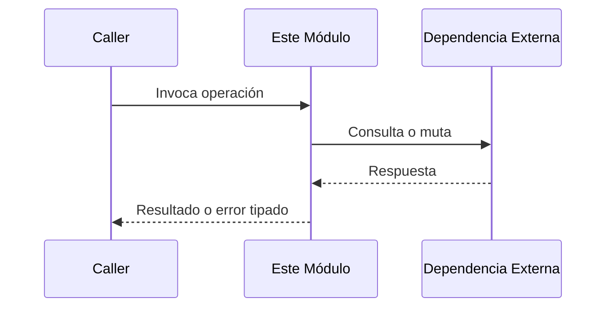

# Módulo: [Nombre del Módulo / Capacidad]

```yaml
module_id: MOD-[slug]
name: "[Nombre Legible]"
target_path: "src/[ruta_o_capa]/"
scope: "block_[scope].md"
owner: "[responsable/equipo]"
version: "1.0.0"
last_updated: "YYYY-MM-DD"
```

---

## 1. Propósito y Responsabilidades

> Resumen conciso (1-2 párrafos) de la función de este módulo, qué problema resuelve y qué fronteras respeta.

### Lo que hace
- Responsabilidad 1.
- Responsabilidad 2.

### Lo que NO hace (Fronteras explícitas)
- Responsabilidad delegada en otro módulo (ej. `MOD-auth`).
- Prohibición arquitectónica específica.

---

## 2. Contratos y Tipos Públicos (CT-*)

> Contratos e interfaces que este módulo expone al resto del sistema.

### CT-01: [Nombre del Contrato o Interfaz]
- **Símbolo / Archivo:** `src/.../nombre_archivo.ext::Simbolo`
- **Firma / Estructura:**
  ```typescript
  // o Dart / Python
  interface NombreContrato {
    id: string;
    // ...
  }
  ```
- **Invariantes del contrato:**
  - Invariante 1.

---

## 3. Reglas de Negocio e Invariantes (BR-*)

> Reglas no negociables que el código debe respetar en todo momento.

- **BR-01:** Descripción de la regla de negocio.
- **BR-02:** Restricción de estado o validación crítica.

---

## 4. Flujos y Procesos Clave

> Descripción de los flujos de ejecución o cambios de estado internos del módulo (antiguos procesos PRC).

### Flujo: [Nombre del Flujo Principal]


- **Paso 1:** Acción inicial.
- **Paso 2:** Validación de invariante.
- **Paso 3:** Emisión de evento o retorno.

---

## 5. Mapa de Implementación

> Símbolos y archivos reales en disco que materializan esta especificación.

| Contrato / Flujo | Símbolo de Código | Ruta en Disco | Pruebas Unitarias |
|---|---|---|---|
| CT-01 | `NombreClase` | `src/domain/nombre.ext` | `test/domain/nombre_test.ext` |
| Flujo Principal | `ejecutarOperacion` | `src/application/operacion.ext` | `test/application/operacion_test.ext` |
